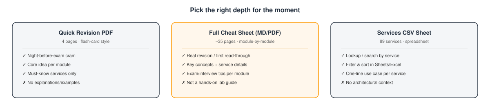
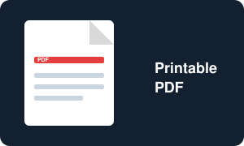
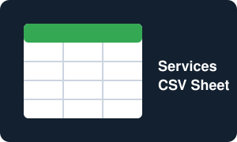
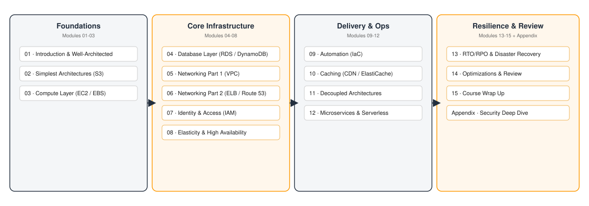

  

# AWS Architecting Cheat Sheet

A student-friendly cheat sheet and service reference, based on the official **"Architecting on AWS" (v6.8)** training curriculum. Built for students and self-learners who want a fast way to review the course — whether that's a deep read-through, a last-minute cram, or a quick lookup of what a specific AWS service does.

> This is an independent study aid, not an official AWS publication. It's a companion to the course, not a replacement for it, the labs, or current AWS documentation — AWS services and pricing change, so always double-check specifics before relying on them for an exam or production decision.

---

## Pick a format

Three ways to use this repo, depending on how much time you have:

  

<table>
<tr>
<td width="33%" align="center">
<a href="cheatsheet/">
 
<b>Markdown Cheat Sheet</b>
</a>
 Read it on GitHub, no download needed
</td>
<td width="33%" align="center">
<a href="pdf/">
 
<b>Printable PDFs</b>
</a>
 Full reference PDF, plus a 4-page quick-revision cram sheet
</td>
<td width="33%" align="center">
<a href="sheets/">
 
<b>AWS Services Sheet</b>
</a>
 Import into Google Sheets or Excel
</td>
</tr>
</table>

| Folder | What's inside | Best for |
|---|---|---|
| [`cheatsheet/`](cheatsheet/) | The full cheat sheet in Markdown — 15 modules + Appendix, renders directly on GitHub | First read-through, searching with Ctrl+F |
| [`pdf/`](pdf/) | Two PDFs: the full reference, and a 4-page abstract "quick revision" cram sheet | Printing, offline reading, exam-day review |
| [`sheets/`](sheets/) | A CSV of all 89 AWS services mentioned in the course, with use case + modules | Looking up "what does this service do again?" |

---

## Course roadmap

The course builds up one architectural layer at a time. Here's how the 16 sections group into four logical phases:

  

- **Foundations** — the minimum viable architecture: static hosting, then compute.
- **Core Infrastructure** — the pieces every real application needs: a database, a network, identity and access control, and the ability to scale and stay available.
- **Delivery & Ops** — how you actually ship and run things: infrastructure as code, caching, decoupling, and modern compute (containers/serverless).
- **Resilience & Review** — disaster recovery planning, a capstone review of the whole course, and a security-focused appendix.

## What each module covers

| # | Module | Headline services |
|---|---|---|
| 01 | Introduction & Well-Architected Framework | Well-Architected Tool, CloudFront, Route 53 |
| 02 | The Simplest Architectures | Amazon S3, S3 Glacier, Snowball |
| 03 | Adding a Compute Layer | Amazon EC2, EBS, EFS/FSx |
| 04 | Adding a Database Layer | Amazon RDS, Aurora, DynamoDB |
| 05 | Networking in AWS Part 1 | Amazon VPC, Security Groups, NACLs |
| 06 | Networking in AWS Part 2 | Direct Connect, Transit Gateway, ELB, Route 53 |
| 07 | AWS Identity and Access Management | IAM, STS, Cognito, Organizations |
| 08 | Elasticity, High Availability & Monitoring | CloudWatch, Auto Scaling, Aurora Serverless |
| 09 | Automation | CloudFormation, Systems Manager, Elastic Beanstalk |
| 10 | Caching | CloudFront, ElastiCache, DAX |
| 11 | Building Decoupled Architectures | Amazon SQS, Amazon SNS, Amazon MQ |
| 12 | Microservices and Serverless Architectures | Lambda, ECS, Fargate, API Gateway, Step Functions |
| 13 | RTO/RPO and Backup Recovery | S3, AWS Backup, Storage Gateway |
| 14 | Optimizations and Review | Capstone review — no new services |
| 15 | Course Wrap Up | Training & Certification resources |
| Appendix | Cloud Economics & Security Deep Dive | Shield, WAF, KMS |

See [`cheatsheet/README.md`](cheatsheet/README.md) for the full breakdown of what's in each module's Key Concepts, Services, and Exam Tips sections.

## How this was built

The content was synthesized from the official AAI "Architecting on AWS 6.8" instructor-led training deck: every module's slide text and speaker notes were extracted, then distilled into structured notes (overview, key concepts, services, exam tips), proofread, and cross-checked against current AWS documentation where a fact needed verification. The original PowerPoint files are **not** included in this repo — only these derived study notes. See [LICENSE](LICENSE) for details.

## Contributing

Found an error or an outdated detail? Open an issue or a PR. Keep additions grounded in the official course content or current AWS documentation, and cite the module or doc page in your PR description.

## License

[MIT](LICENSE) — free to use, copy, and adapt for teaching and study.
